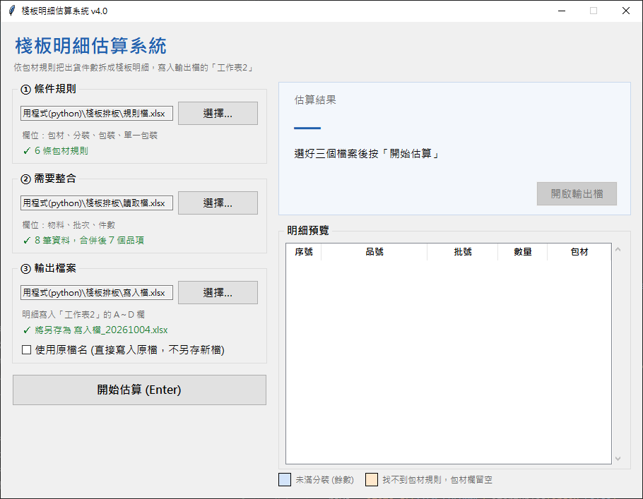

# 棧板明細估算系統

依照包材規則，把出貨品項的件數自動拆分成一筆筆棧板明細，協助在公司快速分類、排板。

> 為了公司出貨排板寫的小工具，重新優化的版本。



## 功能

- 照「① 條件規則 → ② 需要整合 → ③ 輸出檔案」選擇 Excel，開啟就**自動帶入**程式旁的範例檔，並**記住上次的選擇**
- 選好檔案**立即檢查**，欄位缺少、物料空白、件數不是正整數時，紅字指出是第幾列
- 同一「物料＋批次」的件數自動合併，依包材規則拆成多筆明細，剩 1 件時改用「單一包裝」（例如 DRUMS → DRUM）
- 右側**預覽每一筆明細**：未滿分裝（餘數）藍色底，找不到包材規則橘色底並列出物料
- **預設原檔不動**：另存成 `寫入檔_20261004.xlsx`，同一天不覆蓋；勾選「使用原檔名」則直接寫入原檔
- 「開啟輸出檔」一鍵用 Excel 開啟結果

---

## 安裝

### 1. 事前準備

| 項目 | 說明 |
|---|---|
| **Python 3.9 以上** | 到 [python.org](https://www.python.org/downloads/) 下載，或安裝 [Anaconda](https://www.anaconda.com/download) |
| **三個 Excel 檔** | 專案已附 `規則檔.xlsx`、`讀取檔.xlsx`、`寫入檔.xlsx`，格式見下方「Excel 格式」 |

### 2. 下載專案

```
git clone https://github.com/tedchen05/pallet-detail-estimator.git
cd pallet-detail-estimator
```

### 3. 安裝套件

在專案資料夾開啟終端機，執行：

```
pip install -r requirements.txt
```

> 使用 Anaconda 的話，請在「Anaconda Prompt」中執行。

---

## 執行

### 方法一：終端機

在專案資料夾執行：

```
python pallet_gui.py
```

### 方法二：VS Code 按 F5

1. 用 VS Code 開啟專案資料夾（第一次開啟時，右下角會建議安裝 Python 擴充功能，按「安裝」）
2. 按 `Ctrl + Shift + P`，輸入 `Python: Select Interpreter`，選擇**有安裝上述套件的 Python**
3. 按 **F5**

在「執行與偵錯」面板（`Ctrl + Shift + D`）上方可以切換：

| 選項 | 作用 |
|---|---|
| 執行棧板明細估算系統 | 開啟估算視窗（預設） |
| 執行目前開啟的檔案 | 執行目前正在編輯的檔案 |

### 打包成 exe

```
pip install pyinstaller
pyinstaller -F -w -n 棧板明細估算系統 pallet_gui.py
```

產生的 exe 在 `dist/` 資料夾，和三個 Excel 放在同一個資料夾即可使用。

---

## 使用方式

1. 開啟程式，左側三個步驟會自動帶入檔案，確認都是綠色 ✓
2. 要換檔案時按「**選擇…**」，通常只需要換「② 需要整合」的出貨資料
3. 按「**開始估算**」或直接按 Enter
4. 右側顯示「N 筆明細」與明細預覽，按「**開啟輸出檔**」查看結果

> 有橘色提示時，代表這些物料找不到包材規則，請到規則檔補上後再估算一次。

---

## Excel 格式

三個檔案都必須是 `.xlsx`，第一列是欄位名稱，名稱要完全一致（包含全形、半形）：

| 檔案 | 欄位 | 說明 |
|---|---|---|
| 條件規則（`規則檔.xlsx`） | 包材、分裝、包裝、單一包裝 | 物料代碼最後 5 碼含「包材」代號時套用；每筆明細最多「分裝」件 |
| 需要整合（`讀取檔.xlsx`） | 物料、批次、件數 | 出貨資料，同物料、批次的件數會自動合併 |
| 輸出檔案（`寫入檔.xlsx`） | 工作表2 的 A～D 欄 | 寫入品號、批號、數量、包材；寫入前清除舊明細，其他欄位與公式不動 |

- 件數、分裝都要是大於 0 的整數；整列空白的列會自動略過
- 不勾「使用原檔名」時，結果另存成 `原檔名_今天日期.xlsx`，同一天重複估算依序存成 `_2`、`_3`…

**拆分範例**：物料 `PV8000000PC` 共 70 件，規則 PC 分裝 32，拆成 32、32、6 三筆，包材都是 DRUMS；最後一筆 6 件未滿分裝，預覽中以藍色底標示。

---

## 已知限制

- **範本只有 20 個棧板位**：附的 `寫入檔.xlsx` 在工作表2 第 2～21 列有棧板號，第 22 列是合計。明細超過 20 筆時，多出的明細不會出現在工作表1 的棧板清單，合計也不會算到，需要先在 Excel 把範本加大

---

## 常見問題

**Q：出現「被占用，請先關閉檔案再試」？**
該 Excel 正在開啟中，關閉後再按「開始估算」。

**Q：出現「缺少欄位：…」？**
Excel 第一列的欄位名稱和上面「Excel 格式」不一致，或選錯了步驟的檔案。

**Q：出現「第N列件數…不是正整數」或「第N列物料空白」？**
該列資料有問題，程式不會略過，請到 Excel 對應的列修正後再估算。

**Q：某些品項的包材是空白？**
該物料最後 5 碼找不到對應的包材代號，請在規則檔新增一列。

**Q：批次前面的 0 不見了？**
程式以文字讀取批次欄，若 Excel 中原本就存成數字，請先把該欄格式改為「文字」。

**Q：想讓程式回到預設的三個範例檔？**
刪除程式旁邊的 `pallet_settings.json` 再重新開啟即可，這個檔案只記錄上次選的檔案。

**Q：出現 `ModuleNotFoundError: No module named 'pandas'`？**
執行用的 Python 沒有安裝套件。照「方法二」重新選擇 Python，或對目前的 Python 執行 `pip install -r requirements.txt`。

---

## 檔案說明

```
pallet-detail-estimator/
├── pallet_gui.py          # 視窗介面（主程式，執行這個）
├── pallet_core.py         # 核心功能：讀取與檢查資料、拆分明細、寫入 Excel
├── requirements.txt       # 需要安裝的套件
├── 規則檔.xlsx            # 範例：條件規則
├── 讀取檔.xlsx            # 範例：需要整合的出貨資料
├── 寫入檔.xlsx            # 範例：輸出範本（含棧板清單公式）
├── images/
│   └── screenshot.png     # 介面截圖
└── .vscode/
    ├── launch.json        # VS Code 按 F5 的執行設定
    └── extensions.json    # 建議安裝的 VS Code 擴充功能
```
